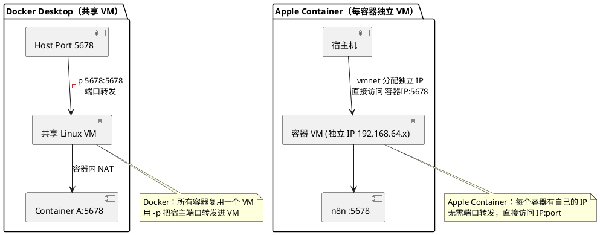

## 目标

在 Apple Silicon Mac 上通过 Apple Container 运行 n8n，实现本地工作流自动化开发环境。完成后可通过浏览器访问 n8n 编辑器，工作流数据持久化到宿主机。

---

## 前置条件

- Apple Silicon Mac（M1/M2/M3/M4）
- macOS 26 或更高版本
- 已安装 Apple Container（参考 [Apple Container 介绍](/posts/apple-container-macos-linux-containers/)）
- container 系统服务已启动：`container system start`

---

## 操作步骤

### 1. 拉取 n8n 镜像

```bash
container pull docker.io/n8nio/n8n:latest
```

验证镜像已下载：

```bash
container image list
```

### 2. 基础运行

最简方式启动 n8n：

```bash
container run --name n8n --detach --memory 1g docker.io/n8nio/n8n:latest
```

查看容器 IP：

```bash
container list
```

输出中会显示容器的 IP 地址（如 `192.168.64.x`），在浏览器访问 `http://<容器IP>:5678` 即可打开 n8n 编辑器。

#### 为什么没有端口映射

如果你习惯 Docker 的 `docker run -p 5678:5678`，会发现 Apple Container 没有 `-p` 参数。这是因为两者的网络模型完全不同：



所以 Apple Container 下访问 n8n 永远是「容器 IP + 端口」，不存在「宿主端口被占用」的问题——每个容器的 5678 端口都在各自独立的 VM 里，互不冲突。第 3 步的本地 DNS 只是给这个 IP 配一个易记的域名，**是可选的便利，不是必需**。

### 3. 使用本地 DNS（可选，macOS 26）

如果嫌记 IP 麻烦，可以配置本地 DNS，用域名代替 IP 访问：

```bash
sudo container system dns create local
```

重新创建容器（如果之前已创建需要先停止）：

```bash
container stop n8n
container run --name n8n --detach --memory 1g docker.io/n8nio/n8n:latest
```

现在可以通过 `http://n8n.local:5678` 访问。

### 4. 数据持久化

n8n 默认将数据存储在容器内 `/home/node/.n8n` 目录，容器删除后数据丢失。

`/home/node/.n8n` 这个路径不是 Apple Container 的约定，而是 **n8n 官方镜像的约定**——n8n 镜像以非 root 的 `node` 用户运行，工作目录是 `/home/node`，n8n 默认把 SQLite 数据库、凭证、执行历史放在 `~/.n8n`（即 `/home/node/.n8n`）。换一个镜像（如 postgres），数据目录就完全不同，需要查对应镜像的文档。

通过宿主目录挂载实现持久化：

```bash
mkdir -p ~/.n8n-data
```

```bash
container run --name n8n \
  --detach \
  --memory 1g \
  --mount "source=$HOME/.n8n-data,target=/home/node/.n8n" \
  docker.io/n8nio/n8n:latest
```

`--mount` 用的是 `source=/宿主路径,target=/容器路径` 语法（key=value 形式）。Apple Container 同时也支持 Docker 风格的 `-v /宿主路径:/容器路径` 简写，两者等价，选哪个看习惯。`source` 必须用绝对路径，`$HOME` 在这里会被宿主 shell 展开再传给 container CLI。

工作流、凭证、执行历史等数据保存在 `~/.n8n-data` 中，容器重建后不丢失。

### 5. 配置环境变量

通过环境变量自定义 n8n 行为：

```bash
container run --name n8n \
  --detach \
  --memory 1g \
  --mount "source=$HOME/.n8n-data,target=/home/node/.n8n" \
  --env N8N_PORT=5678 \
  --env GENERIC_TIMEZONE=Asia/Shanghai \
  --env N8N_SECURE_COOKIE=false \
  docker.io/n8nio/n8n:latest
```

常用环境变量：

| 变量 | 作用 | 默认值 |
|------|------|--------|
| `N8N_PORT` | 监听端口 | 5678 |
| `GENERIC_TIMEZONE` | 时区（影响 Cron 触发器） | UTC |
| `N8N_SECURE_COOKIE` | 是否要求 HTTPS cookie | true |
| `N8N_BASIC_AUTH_USER` | 基础认证用户名 | 无 |
| `N8N_BASIC_AUTH_PASSWORD` | 基础认证密码 | 无 |

### 6. 资源调优

n8n 执行复杂工作流时可能需要更多资源：

```bash
container run --name n8n \
  --detach \
  --cpus 2 \
  --memory 2g \
  --mount "source=$HOME/.n8n-data,target=/home/node/.n8n" \
  docker.io/n8nio/n8n:latest
```

也可以在全局配置文件 `~/.config/container/config.toml` 中设置默认值：

```toml
[container]
cpus = 2
memory = "2g"
```

---

## 结果验证

```bash
container list
```

确认 n8n 容器状态为 running，然后浏览器访问 `http://n8n.local:5678`（或容器 IP:5678），看到 n8n 的注册/登录页面即部署成功。

进入容器检查数据目录：

```bash
container exec n8n ls /home/node/.n8n
```

应看到 `database.sqlite`、`config` 等文件。

---

## 常见问题

**容器启动后无法访问 5678 端口**

根因是还按 Docker 的思路用 `localhost:5678` 访问。Apple Container 每个容器是独立 VM，vmnet 分配的是容器自己的 IP（如 `192.168.64.x`），宿主机的 `localhost` 上并没有这个端口在监听。用 `container list` 查到容器 IP，直接访问 `<容器IP>:5678`。macOS 26 上若嫌记 IP 麻烦，配了 DNS 后用 `n8n.local:5678` 也可以。

如果连 IP 都 ping 不通，先确认 `container system` 服务在运行（`container system start`），再检查 macOS 防火墙没有拦截 vmnet 流量。

**内存不足导致 n8n 崩溃**

n8n 是 Node.js 进程，单进程受 `--memory` 上限约束。典型吃内存的场景是：批量执行工作流（一次处理几百条记录）、HTTP 节点并发回调积压、大文件 Base64 在内存里周转。`--memory 1g` 是能跑起来的下限，遇到上述场景会 OOM 被杀。

从根上避免的做法是按场景给资源：纯调试用 1g 够，跑批量任务给 2g 以上。Apple Container 的限制是容器内释放的内存页不会归还宿主（Virtualization 框架限制），所以长时间跑内存密集任务的容器，即使任务结束内存也不会降，必要时重启容器回收。用 `container stats n8n` 监控实际占用。

**时区不正确导致 Cron 触发时间偏移**

n8n 的 Cron 节点用的是**容器内时区**，而容器默认是 UTC。如果你在界面里设了 Cron 表达式 `0 9 * * *` 期望早上 9 点触发，UTC 下会变成北京时间 17 点。根因不在 n8n，在容器时区没设对。

两种修法：启动时传 `--env GENERIC_TIMEZONE=Asia/Shanghai`（影响 n8n 的 Cron 解析），或在 n8n 界面 Settings > General 里设时区。前者对所有工作流生效，后者只影响显示。生产建议用环境变量，配置即代码、可重现。

---

## 参考资料

- [n8n Docker 部署文档](https://docs.n8n.io/hosting/installation/docker/)
- [Apple Container GitHub](https://github.com/apple/container)
- [Apple Container 介绍](/posts/apple-container-macos-linux-containers/)
