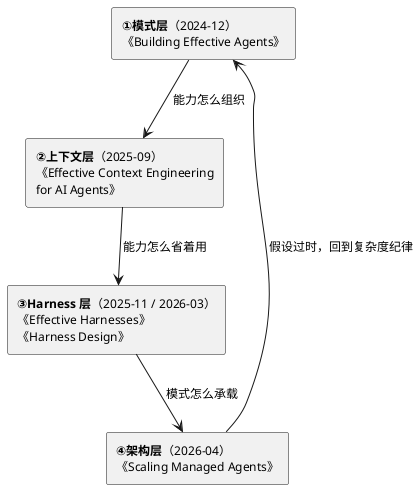
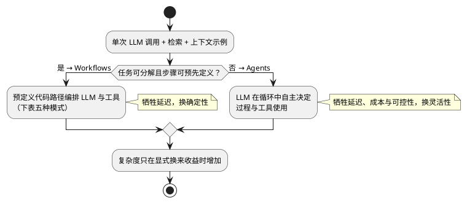
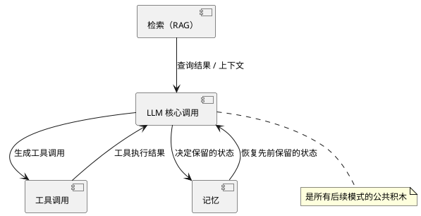
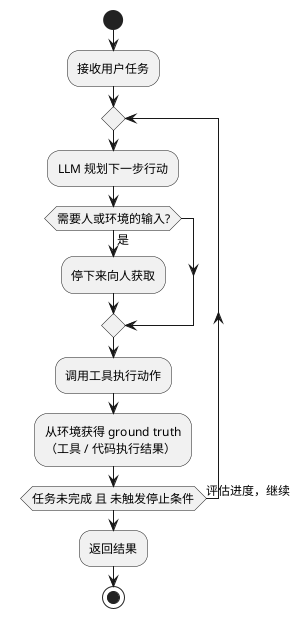
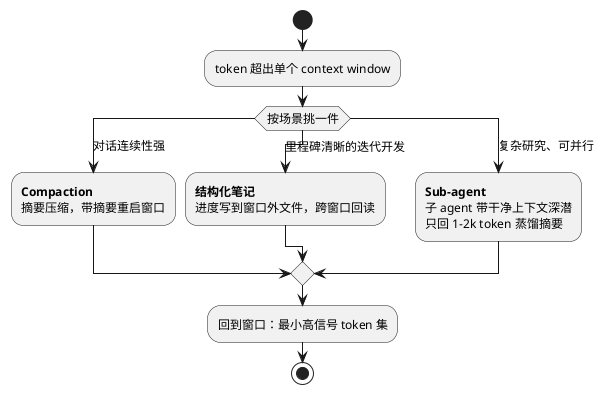
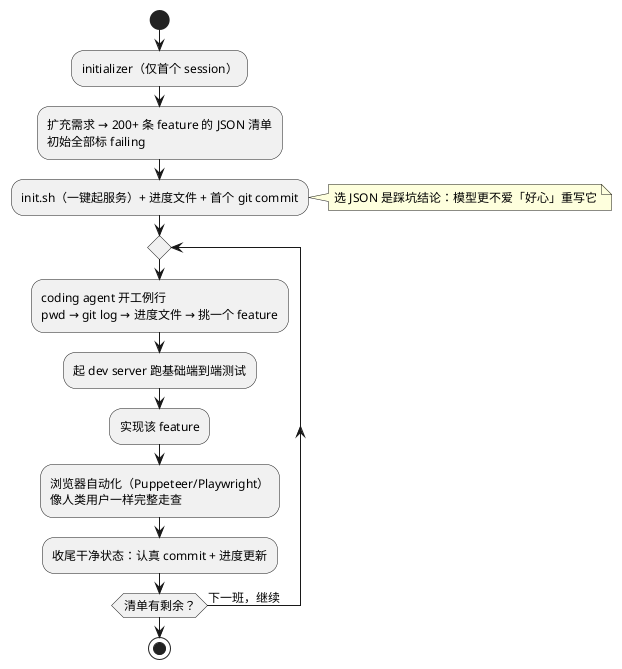
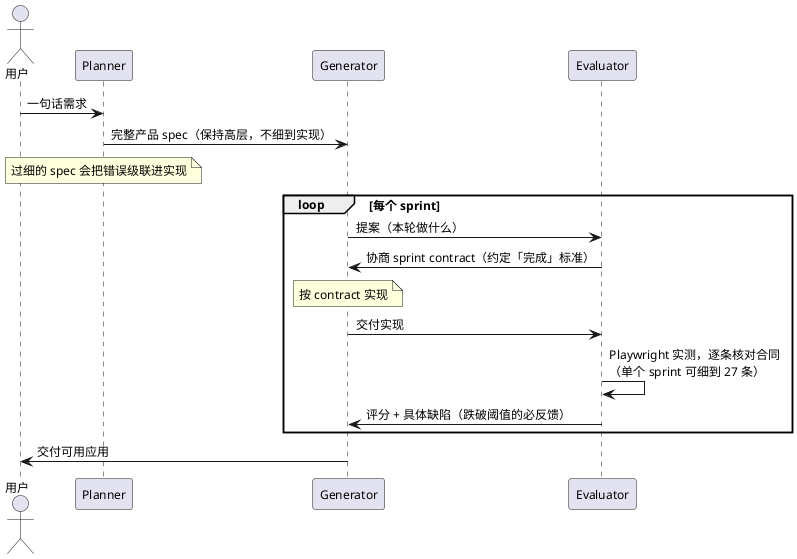
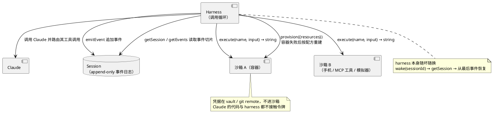

## 概述

Anthropic 工程博客上有一个连续的主题：怎么构建 agent。2024 年 12 月的《Building Effective Agents》定了方法：最成功的实现不靠复杂框架，靠简单可组合的模式。之后一年多，同一批团队又发了四篇，把这套模式往落地的方向推，先后处理了上下文管理、跨窗口长任务、生产架构三个问题。本文按时间顺序整理，八张图，每篇浓缩成一节。

---

## 模式层：怎么组织 LLM 的能力

《Building Effective Agents》（2024-12-19）先做了两个区分。一个是 workflows 和 agents：前者的调用顺序由预定义代码路径编排，后者由 LLM 自己决定过程和工具使用。另一个是复杂度阶梯：能停在单次 LLM 调用就别拆步骤，能拆步骤就别上自主循环。Agentic 系统本质上是在用延迟和成本换任务表现，每加一层都要确认这笔交换值得。

所有模式的公共积木是**增强型 LLM**：一次 LLM 调用带上检索、工具和记忆。模型会自己生成查询、选择工具、决定保留哪些信息。接入外部工具的途径之一是 MCP。

### 五种工作流模式

| 模式 | 做法 | 什么时候用 | 例子 |
|------|-----------|-----------|------|
| 链式 | 固定步骤序列，每步吃上一步输出，可插门控 | 任务能干净分解成固定子任务 | 生成文案→翻译；大纲→校验→成文 |
| 路由 | 按输入分类送进专门下游流程 | 类别差异大、各自单独优化更好 | 客服分流；简单问题走小模型 |
| 并行 | 子任务并行后汇总，拆分与投票两种变体 | 可独立并行，或需多方交叉验证 | 一路回答一路审安全；多角度审漏洞 |
| 编排者-执行者 | 中央 LLM 动态分解、分派、综合 | 子任务无法预定义 | 跨多文件的编码改动；多来源搜索 |
| 评估者-优化者 | 一个生成、一个评价，循环迭代 | 有明确评价标准且反馈有效 | 文学翻译润色；多轮搜索 |

编排者-执行者和并行容易混淆，实际区别在子任务从哪来：并列的子任务是预先定义好的，编排者的子任务是运行时根据输入现场决定的。

### 自主 Agent 循环

Agent 的实现比定义朴素：LLM 在循环里根据环境反馈用工具。SWE-bench 编码 agent 和 computer use 都是这个形态。步数无法预先硬编码，所以才需要模型自主决策。

### 设计原则与 ACI

文章给出的三条原则：保持简单；把规划和执行步骤展示出来让人能干预；像设计人机接口（HCI）那样设计 agent 接接口的部分（ACI）。实现上建议直接用 LLM API 写起，多数模式几行代码，用框架要读懂框架底下实际生成的调用。

ACI 部分是全文工程味最重的地方。做 SWE-bench agent 的时候，Anthropic 花在调工具上的时间比调整体 prompt 还多，几条经验：

- 同一个动作可以用不同格式表达（diff、重写整个文件、JSON、markdown），对人类可无损互换，对模型难度差别很大。写 diff 要求先算出改动的行数，写 JSON 要给换行引号加转义。选格式时考虑三点：给模型先想后写的空间，贴近它训练语料里的自然文本，避免精确计数这类格式开销。
- 只看描述和参数，新人能不能直接用起来？好定义带有示例用法、边界情况、输入格式要求，并说明和相邻工具的分工。
- 让错误难以发生：SWE-bench agent 一离开根目录就写错相对路径，把工具改成强制接受绝对路径后，这个问题再没出现过。

---

## 上下文层：怎么省着用注意力预算

四个月后，《Effective Context Engineering for AI Agents》（2025-09-29）处理的是另一个约束：上下文。引用的依据是 context rot 类研究：窗口内 token 越多，模型精确召回信息的能力越差，所有模型都有这个趋势。架构上 transformer 的注意力让每个 token 都要和其余 token 互相关注，n 个 token 产生 n² 个关系，窗口一长这些关系就被摊薄；长序列在训练数据里本来就少。上下文因此被当成边际收益递减的有限资源来分配：每步只放对目标行为最有信息的几个 token。

各个组件的写法要点，原文给了四条：

- 系统 prompt 写在「正确海拔」上，不硬编码脆弱的 if-else，也不空到假设模型知道你的上下文；用分段结构组织，内容上追求完整刻画期望行为的最小集合。最小不等于短。
- 工具按代码库的标准维护：自包含、容错、职责无歧义。文中给出的自查办法是问「人类工程师能否明确说出该用哪个工具」，答不上来就不能要求 agent 做得更好。
- 示例选没用典型的几条，覆盖不同形态；往 prompt 里塞一整包边界情况清单不是他们推荐的做法。
- 检索可以改成 just-in-time：不预先把数据灌进上下文，给 agent 留轻量引用（文件路径、查询语句、链接），运行时按需加载。Claude Code 分析大数据库就是这么干的：写定向查询、存结果、用 `head`/`tail` 分段消化。代价是探索比预计算慢，需要工具引导，所以 Claude Code 混合了两种做法：CLAUDE.md 直接前置，glob/grep 留给模型按需翻。

### 跨窗口三板斧

单个窗口内放什么解决之后，还有跨窗口连贯性的问题，原文给了三个技术，按场景选用：

Compaction 的难点在留什么弃什么：过于激进的压缩会丢掉后来才显出重要的细节。调整顺序是先用复杂 agent 轨迹最大化 recall，再迭代提精度；最安全的动作是清除历史深处的工具调用和原始结果，后续轮次基本不需要再见到它们。结构化笔记的例子是 Claude 打 Pokémon：agent 在没有记忆结构提示的情况下，自己写出了探索地图、成就清单、对手对策，上下文重置后读着自己的笔记接着执行，能维持「过去 1234 步在 1 号道路训练，Pikachu 升了 8 级、目标 10 级」这样的要求。

---

## Harness 层：怎么跨窗口做长任务

再往后两篇，《Effective Harnesses for Long-Running Agents》（2025-11-26）和《Harness Design for Long-Running Application Development》（2026-03-24），处理同一个问题：agent 跨多个 context window 做长任务时，compaction 也不够。常见的两种失败是赶一步想做完整个应用，中途上下文用完，下一班从半成品现场猜发生了什么；以及后期看一圈进度不错就宣布完工。

### 轮班制：initializer + coding agent

initializer 只跑第一个 session，负责搭环境：写 init.sh、进度文件、首个 git commit，并把用户的 prompt 扩充成 200 多条端到端 feature 的清单，每条初始标记为 failing。清单用 JSON 而不是 markdown 是踩坑之后选定的：模型更不会擅自重写 JSON 里的内容。配套的措辞刻意写重，比如明确写「删除或修改测试可能导致功能缺失，这是不可接受的」。

coding agent 每个 session 推进一个 feature，收尾把代码整理到可以合并主干的水平，认真写 commit message 和进度更新。每个 session 的开场动作写进 prompt：先 pwd，读 git log 和进度文件，挑清单里优先级最高的未完成项，跑 init.sh 起服务，做一遍基本的端到端测试。测试这步看着重复，作用是坏了先修底子，避免在坏掉的底子上添新 feature。测试工具给到了 Puppeteer MCP，只在明确要求「像人类用户一样完整走一遍」之后，标完成但实际没通过的情况才明显减少。

### GAN 式 planner–generator–evaluator

《Harness Design》一篇把轮班制推到了三个 agent，结构上有意参照了 GAN：generator 干活，evaluator 挑刺，两者在循环里对抗。引入第二个 agent 的直接原因是自我评估偏差——agent 给自己产出的东西打分时明显偏于表扬自己，主观任务（如设计）尤其明显。把干活和打分交给两个不同的 agent，比要求 generator 批判自己的产出容易落地：把一个独立的 agent 调得挑剔，只需要改它的 prompt；改一个 generator 的自我评价偏差难得多。

主观质量被翻译成了量表：设计质量、原创性、工艺、功能。权重故意向设计和原创性倾斜，因为工艺和功能模型默认做得不差，「平庸」才是普遍产出。荷兰美术馆的例子展示了这套环路的上限：第 9 轮还是符合预期的暗色落地页，第 10 轮推翻重来，改成 CSS 透视的 3D 展厅、展区用门洞切换。

同一句话 prompt 的游戏编辑器任务，两种 harness 的对比：

| Harness | 时长 | 成本 |
|---------|------|------|
| 单 agent | 20 分钟 | $9 |
| planner/generator/evaluator 全套 | 6 小时 | $200 |

solo 版的界面可以看，核心玩法却没在运行（实体上屏但不响应输入）；harness 版能玩，planner 又按指示把 AI 功能编进了 spec，自带一个用自然语言生成 sprite 和关卡的 Claude 集成。

### 新模型落地，逐个拆掉不承重的部件

harness 里的每个部件都编码了一个「模型做不到什么」的假设。这些假设有可能一开始就是错的，更常见的是随模型进步过时。作者的教训也有一个来回：第一次激进简化做了丢，回来不知哪块承重哪块重；第二次改成一次只撤一个部件、观察影响，而不一次改多处。Opus 4.6 之后的简化结果是：context reset 撤了（context anxiety 消失），sprint 撤了（generator 单个会话连跑 2 小时 07 分，上下文增长交给 Agent SDK 自动 compaction），evaluator 从每个 sprint 都审改成收尾终审一次。一个浏览器 DAW 用简化 harness 跑了 3 小时 50 分、$124.70，QA 两轮抓到的毛病还是「界面在交互空壳」那一类：录音按钮没有 capture，clip 拖拽和分割未实现，效果器只是数字滑条没有 EQ 曲线。

由此得出一条判据：evaluator 不是固定配置。任务在模型单飞可靠完成的边界之外时它才有效；模型进步后这条边界外移，任务一旦落进界内，evaluator 就成了纯开销。

---

## 架构层：怎么承载未来的 harness

最后一篇，《Scaling Managed Agents: Decoupling the brain from the hands》（2026-04-08），关注点从写好一个 harness 换到了给接口做保证。做法参照了操作系统的思路：把硬件虚拟化成 process、file 这样的抽象，接口活得比实现久。agent 被拆成三个抽象：session（append-only 事件日志）、harness（调用 Claude、路由工具调用的循环）、sandbox（执行环境）。三者彼此只做很小的假设，可以独立失败、独立替换。

这些接口设计来自真实的坑。第一版把 session、harness、sandbox 塞进同一个容器，碰到了三件事：容器失联时只能通过 WebSocket 事件流排障，而事件流分不清失败在 harness 的 bug、链路丢包还是容器下线，想进容器调试又碍于里面存着用户数据；harness 假定了 Claude 干活的资源就在自己身边，客户把 Claude 接自己的 VPC 只能做网络对等；凭据和 Claude 生成代码共处一个环境，prompt injection 只需要说服 Claude 读一下自己的环境变量。第三类问题用结构化手段解决——令牌不放进沙箱：Git 在 sandbox 初始化时把仓库令牌注入 remote，push/pull 从沙箱内发起而 agent 全程不碰令牌；MCP 工具的 OAuth 令牌存 vault，专用 proxy 持会话令牌换凭据再调外部服务。

解耦后容器按需 `execute()` 才创建，推理一拉到待处理事件就能开始。生产数据是 p50 首字延迟（TTFT）降约 60%，p95 降 90% 以上。session 充当窗口外的上下文对象，`getEvents()` 支持按位置切片回读。脑和手在数量上都不设上限：多脑等于多份无状态 harness 实例，多手靠统一的 execute() 接口，brain 间还能转交 hand。

Managed Agents 自称 meta-harness：对 Claude 未来需要什么 harness、多少脑、多少手，不假设；Claude Code 也只是接口之下的一种 harness 实现。

---

## 边界与总结

验证场景有两类，共同特征是对话与动作交织、成功标准可度量、有反馈回路：客服支持（有公司已按「成功解决才计费」定价）和编码（自动化测试即反馈回路，但架构级要求仍需人审）。代价同样列出：Agent 的自主性意味着更高成本和误差累积，对策是在沙箱环境做充分测试配合 guardrails，不指望模型在长循环里自己把错误纠回来。

五篇文章各自留了一条可复用的结论：

1. 模式层：最简单的方案优先，复杂度必须显式换来收益；
2. 上下文层：上下文是边际收益递减的有限资源，只放最小高信号 token 集；
3. Harness 层：每个部件都编码一个「模型做不到」的假设，新模型落地就逐个拆掉验证；
4. 架构层：对接口做保证（可读写状态、可执行计算、脑手可多可分离），不对实现下注。

生产路线看 [Managed Agents 文档](https://platform.claude.com/docs/en/managed-agents/overview)；练手长时程系统，官方在 [autonomous-coding quickstart](https://github.com/anthropics/claude-quickstarts/tree/main/autonomous-coding) 放了 initializer/coding 双 agent 的示例。

## 参考资料

- 总纲：[Building Effective Agents — Anthropic](https://www.anthropic.com/engineering/building-effective-agents)（2024-12-19，Erik S.、Barry Zhang）
- [Effective Context Engineering for AI Agents — Anthropic](https://www.anthropic.com/engineering/effective-context-engineering-for-ai-agents)（2025-09-29，Applied AI 团队）
- [Effective Harnesses for Long-Running Agents — Anthropic](https://www.anthropic.com/engineering/effective-harnesses-for-long-running-agents)（2025-11-26，Justin Young）
- [Harness Design for Long-Running Application Development — Anthropic](https://www.anthropic.com/engineering/harness-design-long-running-apps)（2026-03-24，Prithvi Rajasekaran）
- [Scaling Managed Agents: Decoupling the brain from the hands — Anthropic](https://www.anthropic.com/engineering/managed-agents)（2026-04-08，Lance Martin、Gabe Cemaj、Michael Cohen）
- [Managed Agents 文档](https://platform.claude.com/docs/en/managed-agents/overview) 与 [Agent SDK 文档](https://platform.claude.com/docs/en/agent-sdk/overview)
- [Anthropic Agents patterns cookbook](https://platform.claude.com/cookbook/patterns-agents-basic-workflows)
- [Model Context Protocol](https://modelcontextprotocol.io/)
