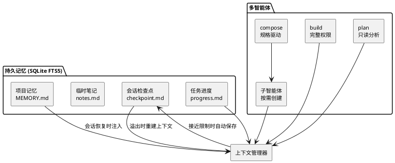

## 简介

MiMoCode 是小米 MiMo 团队开源的终端 AI 编程助手，基于 [OpenCode](https://github.com/anomalyco/opencode) fork 而来。核心特性是跨会话持久记忆和智能上下文管理。MIT 协议，支持接入任意 OpenAI 兼容 API。

## 项目概览

| 属性 | 详情 |
|------|-----|
| 仓库 | [XiaomiMiMo/MiMo-Code](https://github.com/XiaomiMiMo/MiMo-Code) |
| 许可证 | MIT |
| 基础 | fork 自 OpenCode |
| 维护方 | 小米 MiMo 团队 |
| 形态 | 终端 CLI |
| 模型接入 | 任意 OpenAI 兼容 API |
| 核心特性 | 跨会话持久记忆、智能上下文管理、多智能体 |

## 架构与原理

MiMoCode 的核心是「多智能体 + 四层持久记忆 + 上下文自动重建」三者协同——智能体共享会话上下文，记忆在会话间持久化，上下文溢出时自动从记忆重建：



## 核心功能

MiMoCode 将项目知识、会话检查点、临时笔记和任务进度写入基于 SQLite FTS5 的持久记忆。项目规范和架构决策因此可以跨会话保留；恢复工作时，智能体会自动注入相关记忆，而不是要求用户重新描述背景。

上下文管理与这套记忆机制配合：系统在接近 token 限制时保存检查点，溢出后再从检查点、项目记忆和任务进度重建上下文。注入内容受 token 预算约束并按重要性排序，这使长任务能够延续，同时避免历史信息无上限地占用上下文窗口。

多智能体协作通过 `build`、`plan` 和 `compose` 三种主模式划分执行、只读分析与规格驱动编排；系统还可按需创建共享当前上下文的子智能体并行处理工作。任务树和 `/goal` 则为协作提供完成边界：任务状态随检查点保留，智能体准备停止时由独立 judge 模型判断目标是否真正达成。

## 快速上手

```bash
# 方式一
curl -fsSL https://mimo.xiaomi.com/install | bash

# 方式二
npm install -g @mimo-ai/cli
```

首次启动支持 MiMo Auto（限时免费通道）、小米 MiMo 平台 OAuth、从 Claude Code 导入配置、自定义 OpenAI 兼容 API 四种接入方式。

配置文件位置：项目级 `.mimocode/mimocode.json`，全局 `~/.config/mimocode/mimocode.json`，主要配置项包括 Provider/Model 选择、Agent 权限、Checkpoint 行为、MCP 服务器、Keybindings 和主题。

## 参考资料

- [MiMoCode GitHub 仓库](https://github.com/XiaomiMiMo/MiMo-Code)
- [MiMoCode 官网](https://mimo.xiaomi.com/en/mimocode)
- [OpenCode 原项目](https://github.com/anomalyco/opencode)
